# oncall-agent

An agentic SRE incident responder. Given an alert, it investigates like
an on-call engineer would: form a hypothesis, call a read-only tool,
revise the hypothesis from what came back, and keep going until it can
state a root cause and a proposed fix — with every step written to an
audit trail and every state-changing action blocked behind human
approval.

## Project Status

This project is being built in public, one night at a time. See
[`PROGRESS.md`](PROGRESS.md) for the full architecture, the phased build
plan, and exactly where work left off.

**Current phase:** Phases 1–5 are complete — domain models, an
append-only audit trail, a pluggable LLM provider interface with a
deterministic scripted policy, the investigate → hypothesize →
diagnose loop, real Prometheus/kubectl/runbook/deploy-history clients
alongside the original fakes, multi-hypothesis ranking with
contradiction-triggered re-planning, an optional local-model provider
(Ollama), structured diagnosis report export (Markdown/JSON), a human
approval gate (CLI prompt and Slack) in front of every state-changing
action, action executors that only run once a human has said yes, an
incident simulator that fires six fault-injected scenarios through the
full investigate → approve → act loop unattended, and a CLI, all
backed by a full test suite.

## Preview

All screenshots below are real terminal output from the commands shown
— nothing hand-typed or edited.

**`oncall-agent --help`** — the six top-level commands:

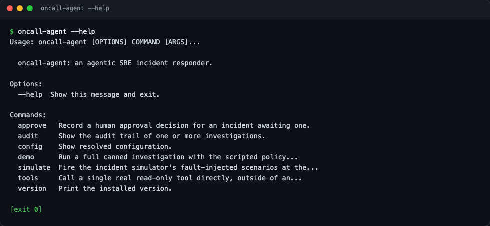

**`oncall-agent config`** — every resolved setting, including the Phase 3 Ollama provider URL/model:

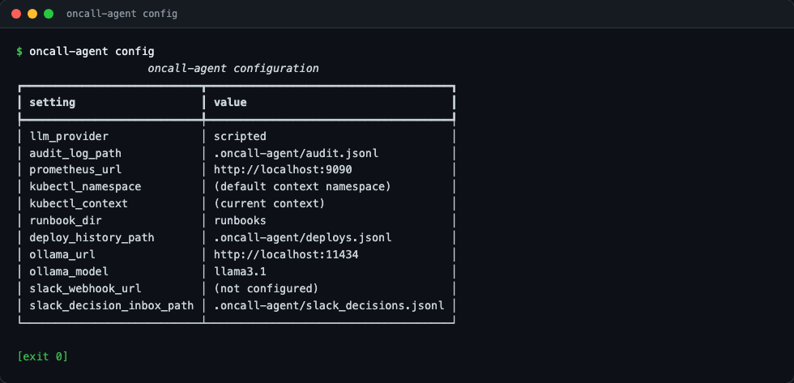

**`oncall-agent demo --scenario deploy-regression`** — a recent deploy drives the diagnosis toward a rollback:

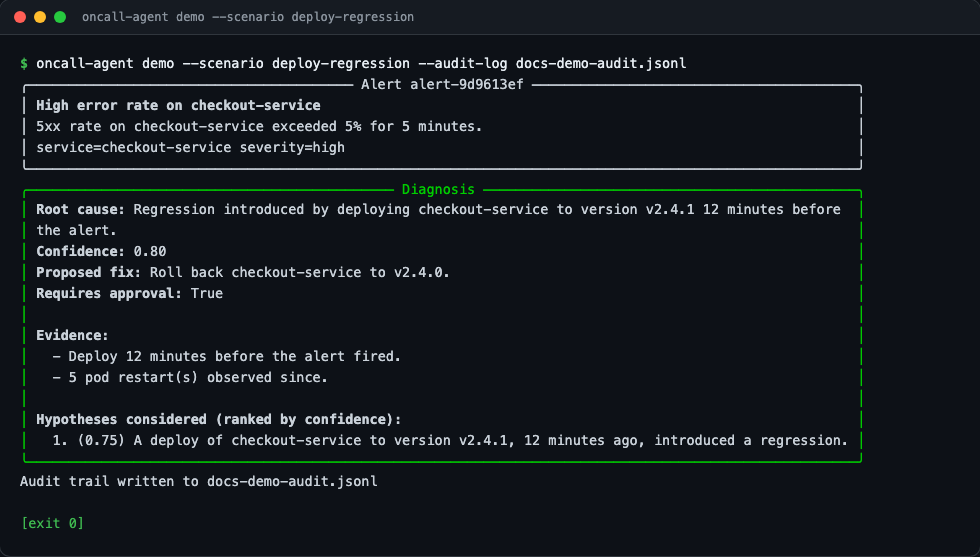

**`oncall-agent demo --scenario oom`** — no recent deploy, pods OOMKilled, fix is to scale up:

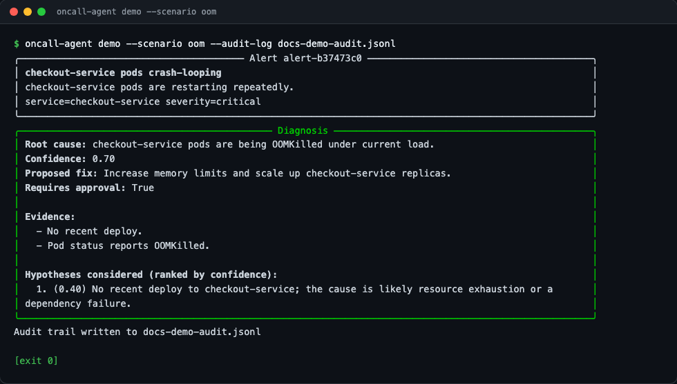

**`oncall-agent demo --scenario unknown`** — pod health contradicts the initial deploy-based guess, so the agent re-plans mid-investigation and the diagnosis lists every hypothesis it considered, ranked by confidence:

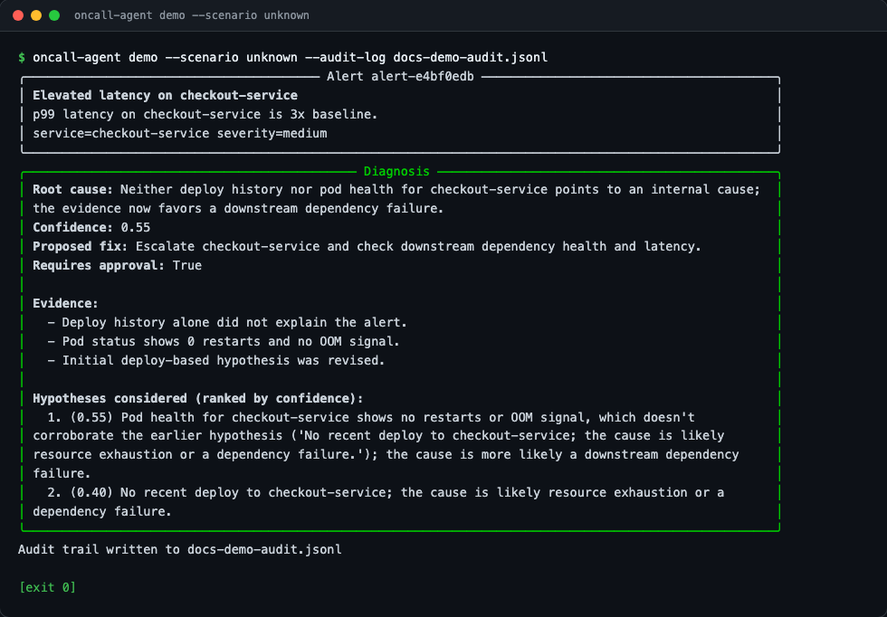

**`oncall-agent audit`** — the full audit trail across all three runs above; note the `hypothesis_revised` event in the third incident where the agent changed its mind:

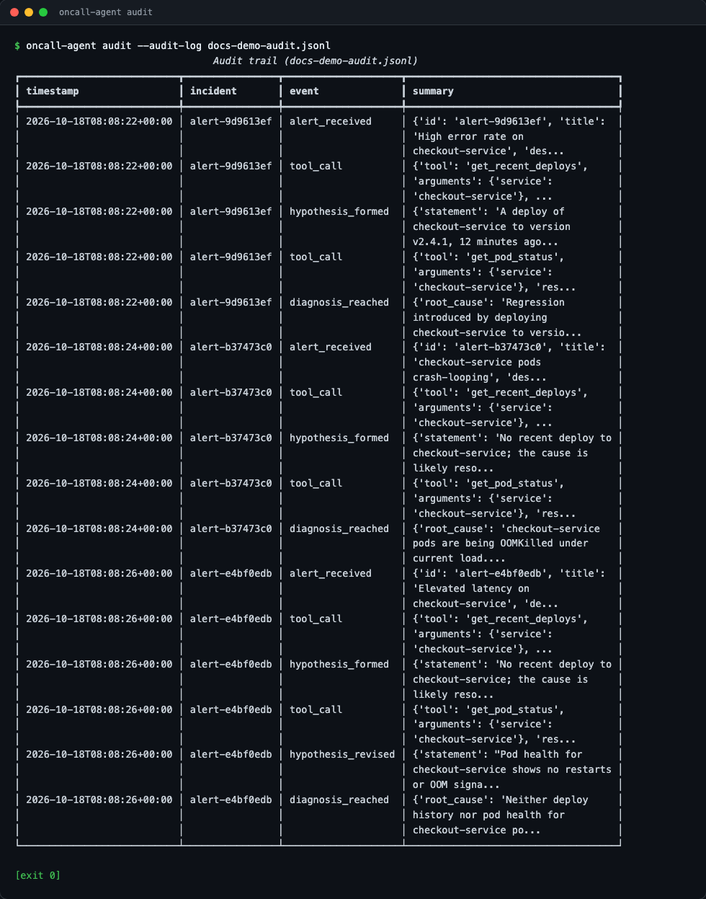

**`oncall-agent demo --scenario bogus`** — invalid input is rejected before anything runs:

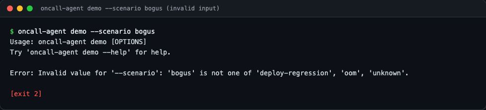

**`oncall-agent demo --scenario unknown --report docs-demo-report.md`** — exporting a structured diagnosis report alongside the usual terminal output:

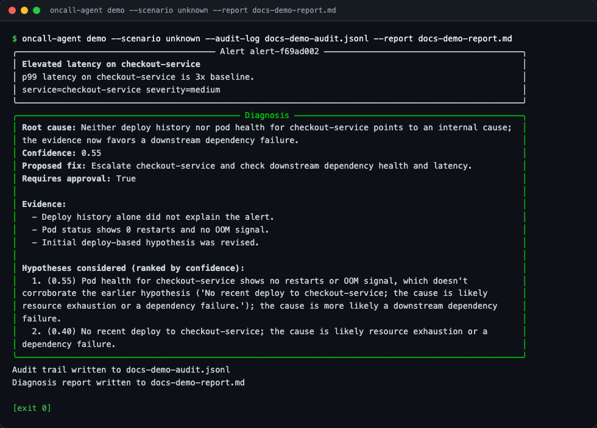

**`cat docs-demo-report.md`** — the exported Markdown report: alert context, diagnosis, evidence, and the ranked hypothesis comparison:

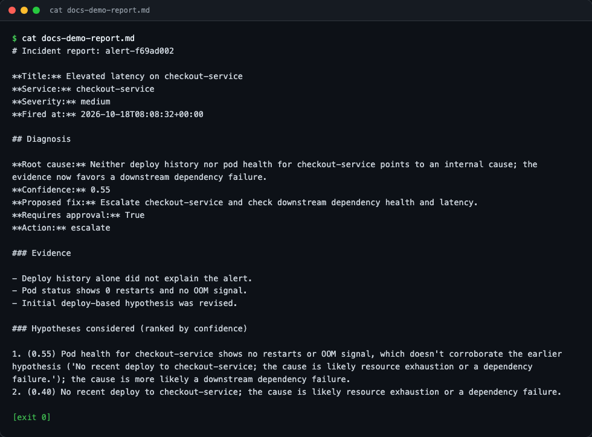

**`oncall-agent demo --scenario deploy-regression --approval cli`** — approving the proposed rollback at the terminal prompt runs it (as a dry run, since `demo` only ever has fake evidence to act on):

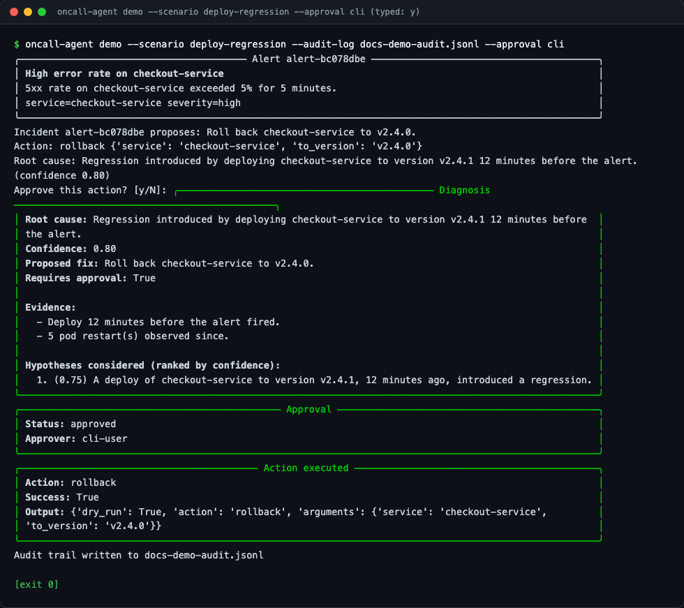

**`oncall-agent demo --scenario deploy-regression --approval cli`** — saying no at the same prompt stops before anything executes:

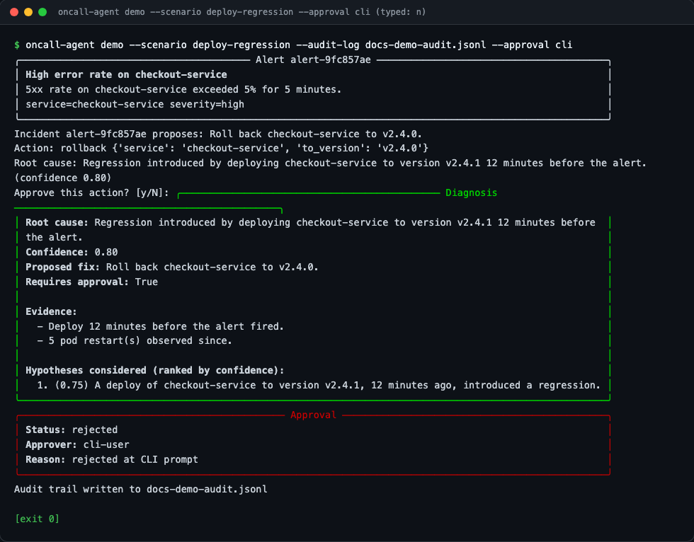

**`oncall-agent approve`** — the manual stand-in for clicking "Approve" on a Slack message; a real Slack app would append to this same decision inbox from its Events API callback, and a `SlackApprovalGate` polling that incident picks it up from there:

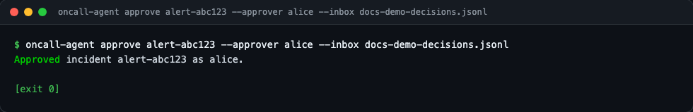

**`oncall-agent simulate list`** — the Phase 5 incident simulator's six fault-injected scenarios, one per runbook:

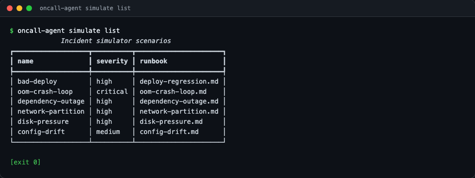

**`oncall-agent simulate run bad-deploy`** — the simulator fires a fault-injected alert through the full investigate → approve → act loop, auto-approved so it runs unattended:

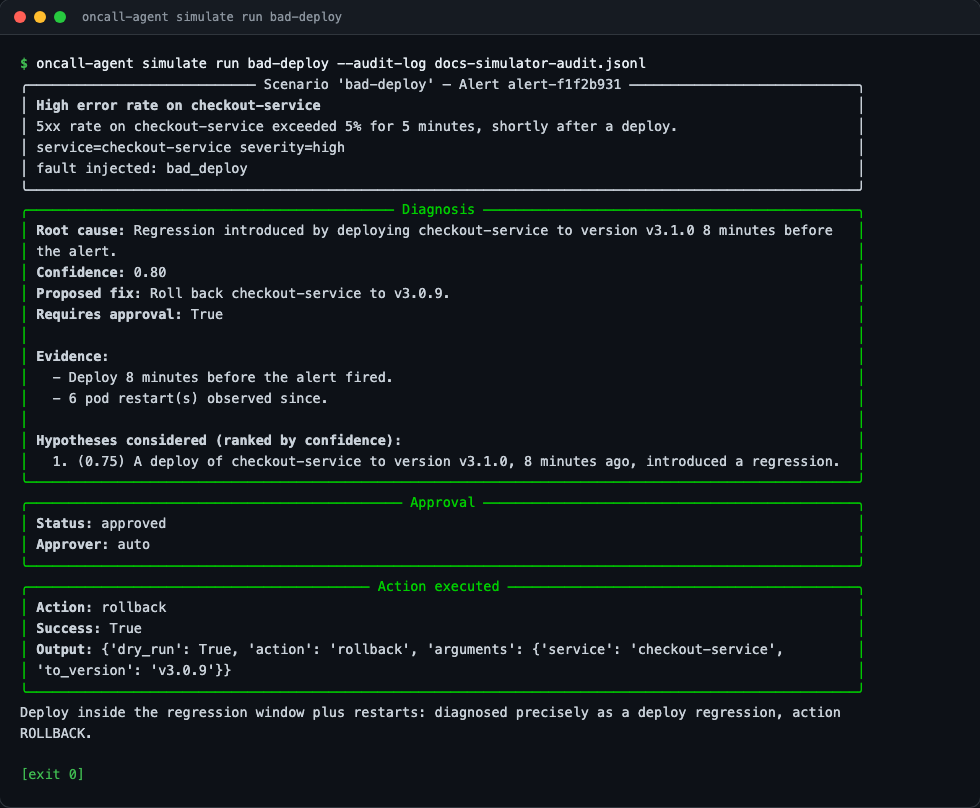

**`oncall-agent simulate run network-partition`** — a scenario the scripted policy can't tell apart from a dependency outage yet, so it escalates with the same generic diagnosis; the scenario's own notes call out the gap:

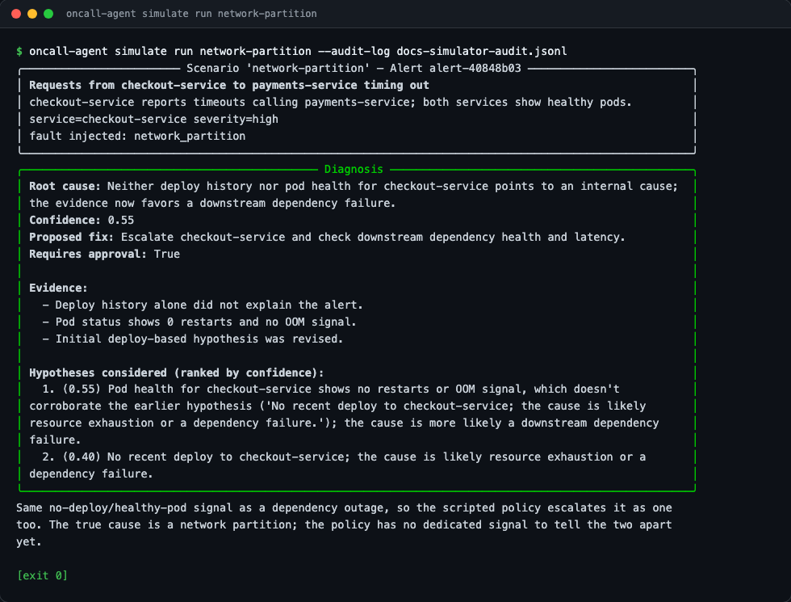

**`oncall-agent simulate run-all`** — all six scenarios in one pass: two precise diagnoses (rollback, scale) and four escalations, one of them taking a visibly different fallback path (disk-pressure) than the other three:

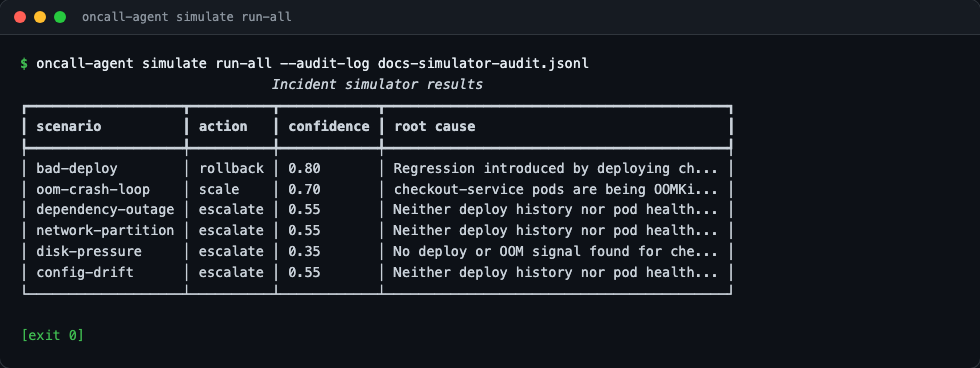

## Why this exists

Real incident response is a loop: look at evidence, form a theory, look
at more evidence, revise the theory, eventually act. Most "AI SRE" demos
skip straight to "and then it fixes it," which is exactly the part that
should never happen without a human saying yes. This project is built
around that constraint from day one: the agent can look at anything
read-only, but every mutating action — restart, rollback, scale — stops
and waits for an explicit approval, logged alongside everything else.

It also doesn't assume you have a paid LLM API key. The default
provider is a deterministic, rule-based policy that needs no network
access at all, which is what tests and CI run against. A real model —
hosted (not yet built) or local via Ollama — is a pluggable
alternative, not a requirement.

Real investigations don't nail the diagnosis on the first guess either.
The scripted policy forms an initial hypothesis from deploy history,
but if the next tool result doesn't back it up at all, it revises
instead of forcing a conclusion it just watched get contradicted — and
the final diagnosis shows every hypothesis it held along the way,
ranked by confidence, so a human reviewing it can see not just the
answer but how the agent got there and what else it considered.

## Architecture

```
src/oncall_agent/
├── models.py          Alert, Hypothesis, Diagnosis, ToolCallRecord, AuditEvent,
│                       ActionType, ApprovalDecision, ActionResult, IncidentResponse
├── audit.py            AuditTrail — append-only JSON-lines audit log
├── config.py            Settings — env-driven configuration (ONCALL_AGENT_*)
├── investigation.py    the investigate -> hypothesize -> diagnose loop
├── reasoning.py         rank_hypotheses / current_hypothesis — multi-hypothesis comparison
├── report.py             export_report — Markdown/JSON diagnosis report export
├── approval.py           ApprovalGate — CLIApprovalGate, SlackApprovalGate, AutoApprovalGate
├── actions.py            ActionExecutor — kubectl-backed and dry-run (Noop) executors
├── response.py           respond_to_incident — investigation + approval gate + action execution
├── llm/
│   ├── base.py          LLMProvider / LLMRequest / LLMResponse contract
│   ├── scripted.py      ScriptedPolicyProvider — deterministic default, re-plans on contradiction
│   ├── ollama.py         OllamaProvider — optional local-model backend
│   └── factory.py       get_provider(name, **kwargs) — swap providers from config
├── tools/
│   ├── base.py           Tool / ToolRegistry contract
│   ├── fakes.py          FakeRecentDeploysTool, FakePodStatusTool (demo doubles)
│   ├── prometheus.py     PrometheusClient / PrometheusQueryTool — read-only PromQL
│   ├── kubectl.py        KubectlClient — get/describe/logs only, never a write
│   ├── deploys.py        DeployHistoryStore/Tool — append-only deploy ledger
│   └── runbooks.py       RunbookSearchTool — keyword search over runbooks/*.md
├── simulator/
│   ├── faults.py          FaultType, FAULT_PROFILES, inject_fault — canned fault evidence
│   ├── scenarios.py        Scenario, SCENARIOS — six incidents, one per runbook
│   └── runner.py           run_scenario / run_all_scenarios — fires respond_to_incident unattended
└── cli.py               click CLI: version, config, demo, audit, approve, simulate, tools
```

`tools/` ships two implementations of the same `Tool` interface: the
Phase 1 fakes (deterministic, used by `demo` and most tests) and the
Phase 2 real clients (`prometheus.py`, `kubectl.py`, `deploys.py`,
`runbooks.py`), reachable directly via `oncall-agent tools <name>`.
Both sides of that interface are interchangeable — nothing above the
`Tool` contract needs to know or care which one it's holding.

`llm/` ships the same pattern one layer up: `ScriptedPolicyProvider`
(the default, deterministic, network-free) and `OllamaProvider`
(optional, talks to a local Ollama server and asks it to return its
next decision as JSON) both satisfy the exact same `LLMProvider`
contract, so `get_provider(name)` is the only place that knows which
one it handed back.

`response.py` ships the same pattern one layer above the investigation
loop: `respond_to_incident` runs `run_investigation` unchanged, and only
if the resulting `Diagnosis.action` is a mutating one (not `None` and
not `ESCALATE`) does it ask an `ApprovalGate` — `CLIApprovalGate`
(prompts the terminal), `SlackApprovalGate` (posts to Slack and polls a
decision inbox), or `AutoApprovalGate` (approves immediately, for
scripted/CI runs) — before handing the action to an `ActionRegistry`.
Nothing in `run_investigation` itself knows an approval gate exists;
`respond_to_incident` is a pure wrapper, same as every other
provider/tool swap in this codebase.

`simulator/` adds a layer *next to* the loop, not inside it:
`run_scenario` builds an `Alert` from a `Scenario`, injects a
`FaultType`'s canned evidence into a fresh `ToolRegistry`
(`inject_fault`), and calls `respond_to_incident` completely unchanged,
with an `AutoApprovalGate` standing in for a human so a whole scenario
suite can run unattended. Six scenarios ship, one per runbook in
`runbooks/`. Two of them the scripted policy diagnoses precisely (a
deploy regression it rolls back, an OOM crash loop it scales up); the
other four (dependency outage, network partition, disk pressure,
config drift) all show no recent deploy and no OOM signal, which is
the only failure shape the policy can currently tell apart from "deploy
caused it" — so it escalates all four, correctly for the dependency
outage and as a safe-but-imprecise fallback for the other three. That
gap is deliberate and documented in each `Scenario.notes` field: it's
exactly what a future scorecard (Phase 6) should be able to measure.

Fault injection here is hand-rolled rather than built on an external
chaos-engineering tool: every existing demo and test in this project
already runs against canned tool evidence (`tools/fakes.py`), the
project has stayed dependency-light on purpose since Phase 1, and nothing
here needs a live cluster to inject a fault into — `FAULT_PROFILES` just
describes, per fault, what a live cluster's tools would have reported if
that fault were real.

Full phase-by-phase plan (the scorecard, provider comparison) is in
[`PROGRESS.md`](PROGRESS.md).

## Installation

```bash
python3 -m venv .venv
source .venv/bin/activate
pip install -e ".[dev]"
```

Requires Python 3.10+. No API key needed — the default LLM provider is
fully local and deterministic.

## Usage

```bash
# print the installed version
oncall-agent version

# show resolved configuration
oncall-agent config

# run a full canned investigation end to end
oncall-agent demo --scenario deploy-regression
oncall-agent demo --scenario oom
oncall-agent demo --scenario unknown

# export the diagnosis as a structured report alongside the audit log
oncall-agent demo --scenario unknown --report incident-report.md
oncall-agent demo --scenario unknown --report incident-report.json --report-format json

# run a full investigation and gate the proposed action on human approval
oncall-agent demo --scenario deploy-regression --approval cli    # prompts y/n at the terminal
oncall-agent demo --scenario oom --approval auto                 # auto-approves, no human (CI/scripted runs)

# inspect the audit trail an investigation left behind
oncall-agent audit

# record a Slack-style approval decision (the human side of SlackApprovalGate's inbox)
oncall-agent approve alert-abc123 --approver alice
oncall-agent approve alert-abc123 --approver alice --reject --reason "too risky, escalate instead"

# fire the incident simulator's fault-injected scenarios, unattended
oncall-agent simulate list
oncall-agent simulate run bad-deploy
oncall-agent simulate run network-partition
oncall-agent simulate run-all

# call a real read-only tool directly, outside an investigation
oncall-agent tools query-prometheus 'up{job="checkout-service"}' --url http://localhost:9090
oncall-agent tools pod-status checkout-service --namespace prod
oncall-agent tools logs checkout-service-abc123 --tail 100
oncall-agent tools search-runbooks "pods crash looping oom killed"
oncall-agent tools record-deploy checkout-service v2.5.0 --previous-version v2.4.1
oncall-agent tools deploy-history checkout-service
```

Each `demo` run drives the real investigation loop — the scripted
policy decides what to check, the fake tools return canned evidence,
and every step is appended to the audit log — so `oncall-agent audit`
afterwards shows exactly how the agent got to its conclusion.

The `tools` group calls the same Phase 2 clients the investigation
loop would, directly: `query-prometheus` runs a PromQL instant query
against a real Prometheus; `pod-status` and `logs` shell out to a
read-only `kubectl` (only `get`/`describe`/`logs` are ever allowed —
anything else is refused before it runs); `search-runbooks`
keyword-searches the markdown corpus under `runbooks/`; and
`record-deploy`/`deploy-history` write to and read from a local
append-only deploy ledger that stands in for a CD system's webhook
history. None of these need a live cluster or Prometheus to build or
test against — every unit test mocks the HTTP/subprocess boundary.

The `demo` command still runs the scripted policy by default. To try
the optional local-model provider instead, point it at a running
[Ollama](https://ollama.com) server:

```bash
export ONCALL_AGENT_LLM_PROVIDER=ollama
export ONCALL_AGENT_OLLAMA_URL=http://localhost:11434
export ONCALL_AGENT_OLLAMA_MODEL=llama3.1
oncall-agent demo --scenario deploy-regression
```

`OllamaProvider` asks the model to return its next decision as strict
JSON matching the same `LLMResponse` shape the scripted policy
produces, so it's a drop-in swap — nothing in `run_investigation` or
the CLI needs to change. It needs network access to the Ollama server,
which is exactly why it isn't the default: tests and CI stay on the
scripted policy.

By default `demo` stops at the diagnosis, same as Phases 1–3 (pass
`--approval skip`, or nothing — it's the default). `--approval cli`
runs the full `respond_to_incident` flow and blocks on a y/n prompt for
any proposed action that isn't a plain escalation; `--approval auto`
runs the same flow but approves immediately, which is what scripted
demos and screenshots use so nothing hangs waiting on a human. Either
way the action itself runs through `ActionRegistry.noop()` — a dry-run
executor — since `demo`'s evidence is all fake and there is no real
deployment to act on. The real, kubectl-backed executors
(`ActionRegistry.kubectl(...)`) are reachable programmatically the same
way the Phase 2 clients are: built to be registered once a live
investigation mode exists, not yet exposed as a CLI shortcut that would
let an action run outside the approval gate.

A `SlackApprovalGate` posts the same approval request to a Slack
webhook (or prints it, if `ONCALL_AGENT_SLACK_WEBHOOK_URL` isn't set)
and then polls a `SlackDecisionInbox` — a JSON-lines file — for the
decision. `oncall-agent approve` is the manual stand-in for the Slack
button click a real deployment would wire up via the Events API: it
appends the same decision shape to the same inbox.

`simulate list` shows all six scenarios and the fault each one
injects; `simulate run <name>` fires one through the full
investigate → approve → act loop (auto-approved, acting through the
same dry-run `ActionRegistry.noop()` the `demo` command uses) and
prints the same diagnosis/approval/action panels `demo` does, plus the
scenario's ground-truth note; `simulate run-all` fires all six and
prints a one-line summary of each outcome. Every run appends to its
own audit log (`.oncall-agent/simulator.jsonl` by default, overridable
with `--audit-log`), inspectable afterwards with `oncall-agent audit`.

## Testing

```bash
pytest -q --cov=oncall_agent
```

200 tests, 99% statement coverage, no network access or API key
required — this is also what CI runs. The real Prometheus/kubectl
clients, the optional Ollama provider, and the Slack approval gate are
all tested by mocking the HTTP/subprocess boundary, so the suite never
needs a live cluster, metrics backend, local model, or Slack workspace.

## License

MIT
